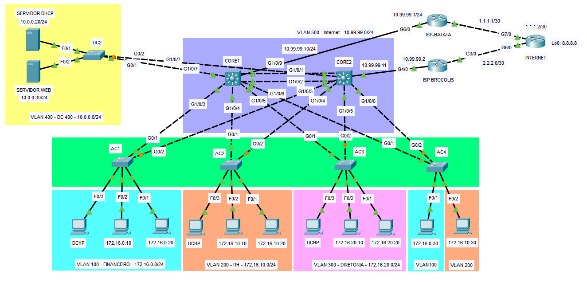

# Rede Corporativa Redundante com HSRP

Lab de rede corporativa em alta disponibilidade, montado no Cisco Packet Tracer.
A camada core é redundante, o acesso é segmentado por VLANs e a saída para a
Internet passa por dois provedores.

**Criado em:** abril de 2025

## O que a rede faz

- **Gateway redundante:** CORE1 e CORE2 compartilham o gateway de cada VLAN via
  HSRP v2. O CORE1 é o ativo (priority 120, preempt) e o CORE2 assume se ele cair.
- **Camada 2 sem loops:** STP com o CORE1 como root nas VLANs de usuário e link
  agregado LACP (EtherChannel) entre os dois cores.
- **Segmentação:** três VLANs de usuário (Financeiro, RH, Diretoria), uma VLAN de
  data center e uma VLAN de borda, com trunks 802.1Q entre cores e acessos.
- **DHCP centralizado:** o servidor fica no data center e atende todas as VLANs
  por DHCP relay (`ip helper-address`) nos cores.
- **Saída para a Internet:** rotas default nos cores e NAT overload nos
  roteadores dos ISPs.
- **Controle de acesso:** ACL no CORE1 impedindo que a VLAN Financeiro acesse o
  servidor Web por HTTP e HTTPS.

## Endereçamento

| VLAN | Nome        | Rede            | Gateway virtual |
|------|-------------|-----------------|-----------------|
| 100  | Financeiro  | 172.16.0.0/24   | 172.16.0.1      |
| 200  | RH          | 172.16.10.0/24  | 172.16.10.1     |
| 300  | Diretoria   | 172.16.20.0/24  | 172.16.20.1     |
| 400  | Data center | 10.0.0.0/24     | 10.0.0.1        |
| 500  | Borda       | 10.99.99.0/24   |                 |

Servidores: DHCP em 10.0.0.20 e Web em 10.0.0.30.

## Topologia

| Equipamento | Função |
|-------------|--------|
| CORE1 / CORE2 | Switches L3: gateway HSRP, roteamento e saída para os ISPs |
| AC1 a AC4 | Switches de acesso com trunk para os dois cores |
| DC2 | Switch do data center (servidores DHCP e Web) |
| ISP-1 / ISP-2 | Roteadores de borda com NAT overload |
| Internet | Roteador que simula a Internet (loopback 8.8.8.8) |

## Tecnologias

Cisco Packet Tracer, HSRP v2, VLAN e trunking 802.1Q, STP, EtherChannel (LACP),
DHCP relay, rotas estáticas, NAT overload, ACL.

## Como abrir

Abra `topology/lab.pkt` no Cisco Packet Tracer. As configurações de
cada equipamento estão em [`configs/`](configs/).
